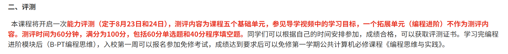

# 新生第一课与开学考

## 新生第一课有必要学吗？

**没有必要**。

这玩意又不影响保研啥的，属于二课（第二课堂，我校特色）。二课不 pass 会影响毕业（也只会影响毕业了），你真没完成导员会给你想方设法过的。哪个学院没事干拿二课卡毕业啊，这影响他们准时毕业率的。

## 开学考

**一般来说，开学考除了计算机线上测试，都不能说是必考。**

**考试具体信息见迎新系统。**

### 英语

英语分班测试有必要参加，分班的目的是为了把相近水平的学生分到一起便于教学，而不是直接给你贴上好与差的标签。**希望小灯能搞清楚这一点，而不是毫无意义地去过度重视分班测试。个人认为英语能力还是非常重要，到校外再去学就很贵。** A 班学术英语写作（高级）为例，会教你查数据库，引用格式，论文体裁，这对于你今后的学术发展都很重要，属于很基础的技能；就算不想碰任何学术类的东西，你总得写毕业论文吧？

2025 级起，A 班免修学术英语读写、听说两门课程。所以分级测试还是很值得参加的。

据传 2026 级开始，全校通修 4 学分英语课。具体以通知为准。

往年这两门课的难度还是比较大的。

**`为了避免小灯过度重视分班测试，这里不会再放分级测试的详情。`**

### 高等数学、大学数学衔接课程

高数是**免修考试**，绝大多数同学 handle 不了。开学想打 cmc 的同学可以考虑一下，用这个来检验你的高数自学成效。**无论如何，高数免修很爽，**并且第一学期免修考难度低于第二学期。

**大学数学衔接课程**部分专业要求参与线上考试，然而不参加也没有任何影响，里面的内容稍微学一下就好了，确实是高等数学要用到的（无非是三角函数、极坐标系啥的）。

### 计算机（CS101；CS for All）

**计算机有个每个新生（计算机类专业除外）都必须 pass 的线上测试**（见迎新系统）。如果没有 pass，开学后要补测，甚至补修相关课程。

<del>我觉得《编程思维与实践》免修选拔方式（线上测试筛人，再线下真人快打）非常不合理，</del>**<del>只能筛选出会搜题的同学。</del>**<del>这和英语的分级考完全不同：英语分级考线上部分虽然不监控屏幕，但是时间很紧张，而且即便你会查词也没啥用，基本上杜绝了科技哥开挂的可能；就算你这么能开，线下考你还是会抓瞎。至于 Python 会不会写，我管你这那的，领导把线上考试的流程走完就行了。所谓的"信息素养第一课"对学生有用吗？难说，我觉得真不如学习和考核《提问的智慧》相关内容对学生的益处大。</del>

<del>总之数据学院计算机教学部的公共计算机课程，免修方式相较于公共英语、公共数学，还是有一定改进空间。</del>

更新：今年计算中心学乖了，去年开挂太多导致线下快打线从 54 变成了 55（因为踩线的太多了）。今年加入了 40 分程序填空题。也算是一个好的变化吧。

这个课程还算是一个合适的扫盲课程。考虑很多同学宽带、校园网、路由器、Wi-Fi 都分不清，还是有必要认真学一下，以免变成赛博丁真<del>（本人承诺自觉遵守何不扩散条约。）</del>

此外，线下部分变成了**自愿报名参加**的**免修考试**，而非根据线上成绩筛选。对自己 Python 程序设计水平有自信的同学可以试试。（没考过；可以参考《编程思维与实践》期末考试）

课程配套教材没有必要购买。浪费钱。

## 开学英语分层考试影响四六级吗？

**没有任何影响**。

由于 12 月考次报名期间小灯的学籍没弄好（另一说是学校教室不够？），所以大一上不能考四级。

**大一下（入学次年 6 月考次）才可以考四级**。

---

*[内容整理自社区手册 ecnu-guide（CC BY 4.0），作者 Nya桑 等，见 [关于本站](../about.md)。]*
