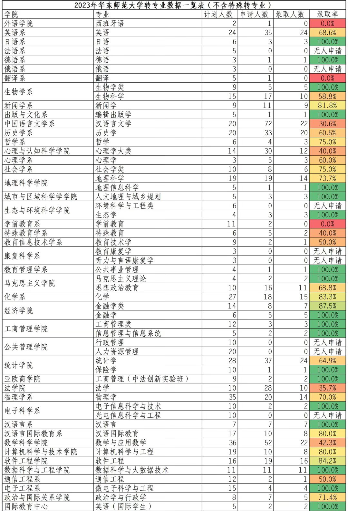

# 转专业

首先阅读我校转专业相关规定：

> [《华东师范大学本科生转专业工作细则（2025 年 5 月修订）》](https://bksy.ecnu.edu.cn/86/07/c40559a689671/page.htm)（节选）
>
> 第二章第四条
>
> 在学期间，学生对非在读专业有兴趣或专长的，可提出转专业申请。**转专业类型包括学校集中组织转专业（以下称一般类型转专业）、基于专业课程学分修读转专业（以下称学分修读类型转专业）和卓越学院选拔转专业。**
>
> （一）**一般类型转专业**在**春季学期**进行，由本科生院组织学部院系**集中开展**。学生通过综合考核，达到要求，方可转专业。
>
> （二）**学分修读类型转专业**由**列有转入计划的学部院系**组织，一般在**秋季学期**进行。学生应达到指定课程修读要求，方可转专业。
>
> （三）**因卓越学院选拔调整专业的，属于转专业**。
>
> 第五条
>
> 除下列情形外，学生均可申请转专业：
>
> **（一）国家或者学校招生规定对转专业有禁止性或限制性规定的，按照相关规定执行。外语类保送生、定向生、艺体类学生、体育特长生、强基计划学生、公费师范生等，仅在规定允许的范围和条件下申请转专业。**
>
> （二）**自入学起已进入第四学年；**
>
> （三）已有过转学经历；
>
> 第三章第九条
>
> 涉及卓越学院转专业，根据卓越学院相关管理规定开展，不受专业计划数限制。
>
> 第十条
>
> 涉及公费师范生转专业，根据《教育部直属师范大学本研衔接师范生公费教育实施办法》施行，**报生源所在省份省级教育行政部门审批。**
>
> 第十一条
>
> 参军退伍学生和认定为创业休学学生申请转专业不受专业计划数限制，应符合国家相关规定和招生考试相关规定。学生复学时向本科生院提出申请，由转入单位组织考核，考核通过后，学生转入该专业。
>
> 第十二条
>
> 双学士学位项目学生退出至**录取专业**，由该专业所在单位审核，不归入转专业。

转专业相关问题可加入转专业咨询群**683137232****（不能邀请进群）**，咨询转专业相关问题。

**在这个群最好也别问蠢问题，不然可能会被蛐蛐。**

**考虑转专业之前需要考虑自己的家庭情况、职业规划、专业志趣，而不是一味追求"就业前景""专业排名好""轻松"。**

25-26 学年的转专业选拔实际上在秋季学期 18 周后一周开展，通过的同学在新学期转入新专业。不排除本学年也这么干的可能性。愚以为这是个非常好的措施，可以在一定程度上减少本科修读时间，这样很可能还能四年毕业。大部分院系都进行了平转，部分院系会进行降转。

以下内容摘自华师大安徽招生组宣传文件（我也参与编辑了）。

## 原则：转出无门槛，转入需考核

一般来说，转出专业不设门槛，学校要求院系提供的各专业转入招生计划人数不低于该专业该年级现有学生人数的 15%。**在国家政策许可的范围内**（对高考生来说，就是艺体类学生只能在对应类别转专业；国家优师计划、公费师范生**只能在限定范围内转专业**且**需要省厅同意**）对各专业允许转出的名额、条件不作限制、不设立门槛。

要想成功转专业，需要通过转入专业的相应考核（笔试，或面试，或二者皆有）。

热门专业竞争会较为激烈，具体请参见下面的表格。

## 成功率如何？

每年申请人数约 600-700 人（占每届学生的 16%-20%），转专业成功率为 60% 左右。

（2023 年华师大转专业数据如下，表格为学生自发整理。你问为什么没有 24 的？主播忘了。为什么没有 25 的？什么叫学校到 26 年 7 月还没发？）

---

*[内容整理自社区手册 ecnu-guide（CC BY 4.0），作者 Nya桑 等，见 [关于本站](../about.md)。]*
