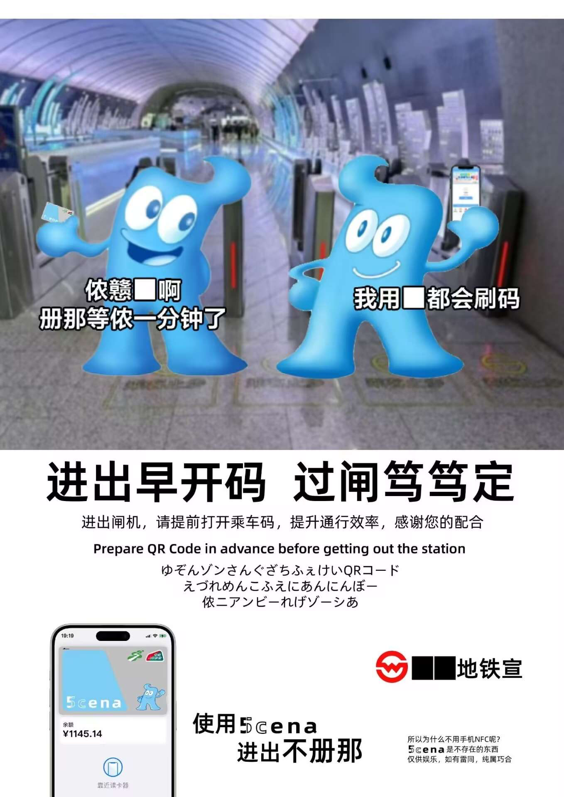
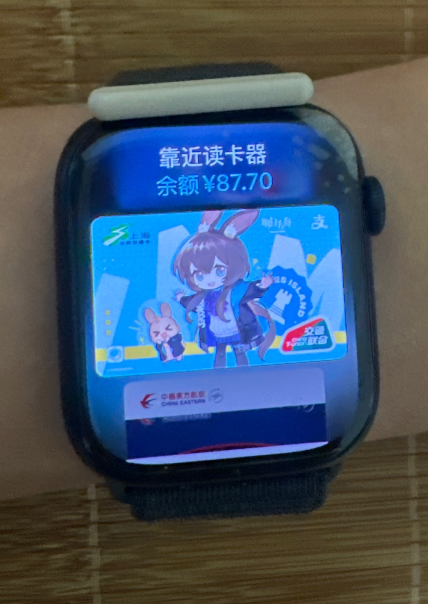

# 校园卡与校园宽带

分清楚这几个概念。

其中也涉及很多 IT 服务相关内容，可参见[实用工具 · IT 基础](../tools/it-basics.md)。

## 校园卡

**校园卡（校园一卡通）**是便于你在校内享受各种服务的工具，可以让你享受食堂和校内商家消费、图书馆、研讨室、体育测试、浴室、各种门禁、校车等服务。总之，需要身份验证和消费的地方都需要用到校园卡。

**别把你的生活费都存到校园卡里。**一次充两百**即可**。

### 人脸识别和校园卡证件照

建议在可以登录 ECard 小程序之后，**尽快更换（上传）证件照**，具体要求请见新生入学手册。否则你的高考录取照片（就是你高考报名拍的那张）会作为你的证件照印到你的校园卡上。想更换也很简单，在小程序重新上传，再补办一张校园卡即可。

如果上传不了证件照，是正常的（也许）。**还是那句话：华师第一课，学会等待。**

如果仍有问题，可向信息办咨询。

### 校园卡服务

校园卡和校园卡服务并不仅限于入学时发的那张卡。事实上**校园卡服务**载体包括：

- **实体卡**（等级最高，丢失请及时挂失并补办）；
- **NFC 校园卡**（联名上海交通卡·全国交联版）；
- **华东师大 ECard 微信小程序**（可以生成校园卡二维码，用于消费和验证；还可以授权**人脸识别服务**，在进校门的时候刷一下脸还是很方便的，但论进图书馆的识别速度那还是不如实体卡/NFC）。

这些载体为同学们提供了多样的校园卡使用选择。<del>（脖子上喜欢挂卡的一般是纯纯的大一小灯）</del>

部分使用场景仅接受实体卡，比如**学校的各类考试**（需要看校园卡照片）、浴室（不想用用水口令就只能用实体卡。在浴室里扫二维码并不现实）、图书馆借阅机器、体测。

还有部分使用场景不能使用 ECard，点名部分宿舍（学校正在逐步更换中）的电子门锁。该门锁仅支持通过实体校园卡、NFC 校园卡或宿管阿姨的备用机械钥匙开锁，甚至不支持扫码开锁，也不知道是谁想出来的。

### ECard

**ECard 使用指南参见[这里](https://docs.ecnu.edu.cn/docsify/#/ecard)。**（需要统一身份认证）

### NFC 校园卡

**NFC 校园卡**可以在**上海交通卡 app** 的校园联名卡专区，通过绑定统一身份认证账号领取。你也可以方便地把它转移到其他手机上或智能穿戴设备上。（参考：转移上海交通卡）其本质是在校园卡系统里记录这张交通卡的卡号，将其**认为是**校园卡。

具体操作方式见 <https://eoffice.ecnu.edu.cn/86/ad/c6632a624301/page.psp>（需要统一身份认证）

显然，交通卡和校园卡也是**不共享余额**的：它们属于两个不同的系统，**不同的结算主体**。

**强烈建议你开通一张上海交通卡·全国交联版（华师大联名版）。常驻上海，还是最好办一张上海的卡，反正也是电子的，0 开卡费（Apple 平台）。**

其好处包括**换乘优惠（地铁公交互相换乘减一元）、地铁累计打折（满 70 元后 9 折）**、二卡合一、通行全国（基本上没啥特殊）等等，不再赘述。**绝对是吊打这个码那个码的体验。**

> 别人：乘车码扫半天进不去，堵住了闸机，后面的乘客非常焦急，他们嘴里甚至传出了一些*沪上雅言*。
>
> 我：一下就刷开了，非常优雅地走过去了。
>
> 就很……你懂吧？

对于 Apple 设备用户（iPhone 和 Apple Watch），借助 iCloud，这些卡的开通、使用和转移绝对是丝滑的体验。其他设备需要依实际情况为准。

（你说的对但是兔兔真的很萌）（兔兔。。嘿嘿。。兔兔）

> Apple 用户可能遇到一个问题。如果你有多张卡，刷 NFC 时可能识别到其他的卡并导致刷不通。这种情况请设置快捷交通卡为校园卡。

## 校园宽带

见[实用工具 · IT 基础](../tools/it-basics.md)中的「校园网，宿舍宽带」。

---

*[内容整理自社区手册 ecnu-guide（CC BY 4.0），作者 Nya桑 等，见 [关于本站](../about.md)。]*
