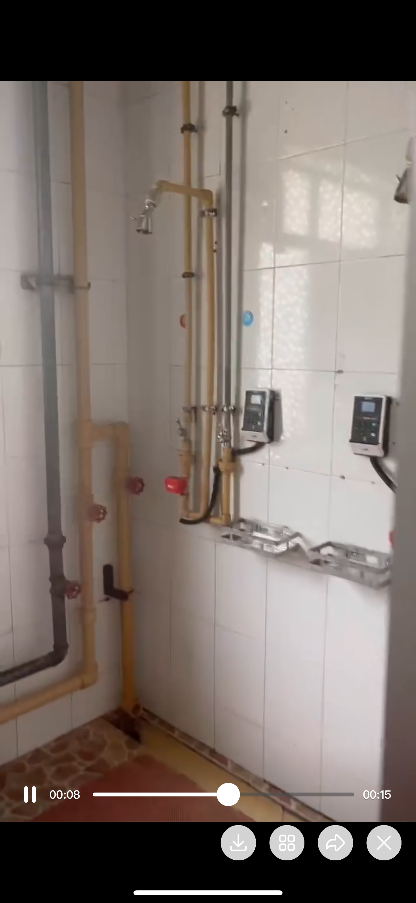
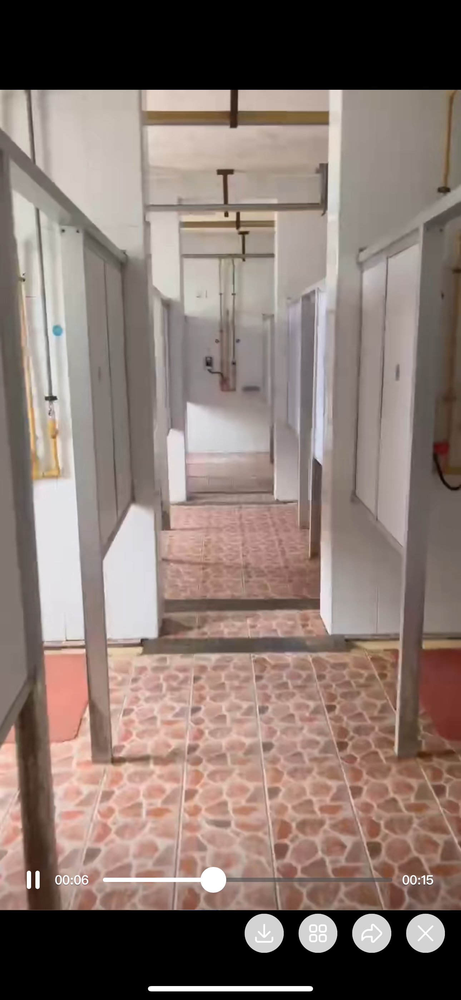
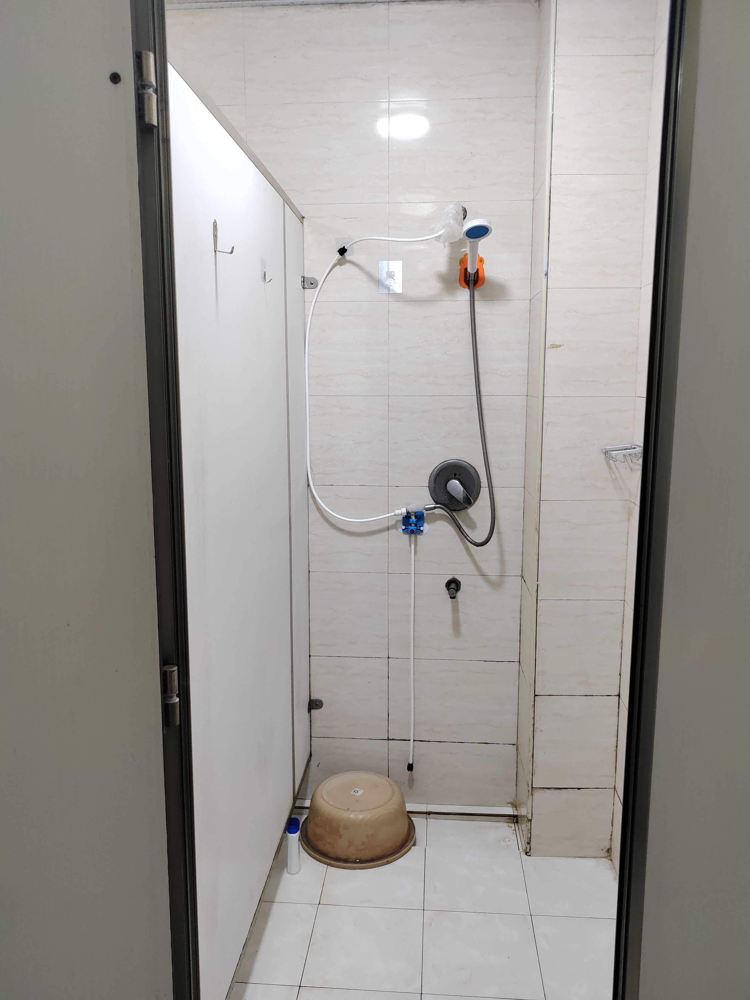

# 宿舍与用水

## 宿舍几人间？

闵行四人间，普陀各异。闵行也存在转角宿舍只住三个人的情况。具体看皮皮的《致新生》。

## 宿舍给用电吹风 / 冰箱 / 小锅吗？

**原则上不行<del>（实际上可以）</del>**。

<del>阿姨不会翻关上门的柜子（）</del>**<del>（阿姨甚至会说下次放柜子里）</del>**

宿舍一般**不限制用电功率，只限制种类。**

当然，你如果被抓到，就只能说时运不济了……**用完记得收起来！**

## 浴室开放时间，浴室条件？

### 闵行校区

#### 开放时间

**10:30-00:00 开放（以 22 号楼为例）**，具体时间因各个宿舍楼阿姨为准。

会有一段时间只许进不许出（关上浴室前）。在这段时间内，你也许可以偷溜进去，但也可能会被阿姨直接拦下，所以不建议这个时间段内去洗澡。

#### 硬件情况

每栋宿舍楼一层有公共浴室，浴室分割成了 n 个小单间，每个单间都是 4 个位置。

如图展示的是，闵行校区**未翻修**的浴室，拍摄时间为 2025 年暑期。（鉴于学校正在开展翻修，您可以期待更新更好的浴室。大部分浴室已经完成翻修）

翻修之后的内部布局无太大变化，但硬件设施更新不少，如下：

- 更衣区域没有厕所了，取而代之的是能出热水的龙头、大的盥洗池和大镜子；
- 隔间有所增加，且增加了一些帘子，还有那种社恐小角落；
- 地面从瓷砖更换成了透水砖，耐脏还不容易积水，提升了安全性，降低了维护成本；
- 增加了排水地漏；
- 储物柜全部更新；
- 花洒从下图中的换成了一般家里的头顶花洒+手持式花洒+冷热水调节器。

（闵行注重隐私的同学可以买帘子挂在**右图所示走廊尽头最后一个热水器**那里，就有单独空间了）

### 普陀校区

#### 开放时间

15:30-23:00

#### 硬件条件

随缘。有独立浴室，但是无热水的，可自行购买洗澡神器使用。有去楼外大澡堂的。

## 用水情况

上海的自来水供水质量是一比一的差。显然，直接喝自来水并不明智。

> 你觉得这开水是能喝的，它就是能喝的；你觉得它不能喝，它就不能喝。
>
> ——修开水机的大叔

### 闵行校区

1. 生活用水：大多数卫生间有热水器可以打热水。学校声称这是*生活用水*，而非*饮用水*，也就是说喝出问题不管他们事……（这还是 24 年中北三舍事件后大家才知道的）

2. 饮用水：宿舍楼里会有多个直饮水机提供饮用水（比较便宜），教学楼、图书馆、院系楼等内部也会有免费饮用水。想要在宿舍饮水可以自购瓶装水（个人饮水），另外，也可以订购学校的桶装水（在寝室随时可以喝到，集体饮水），买水票会送饮水机（分大小），安置在寝室内，需要和舍友协商决定。`--------注意寝室门口的桶装水广告`

### 普陀校区

1. 生活用水：宿舍楼内盥洗室有热水机，水质差，*不建议*直接饮用。

2. 饮用水：宿舍楼里的净水器（直饮水机）有饮用水，教学楼、图书馆、院系楼等内部也会有免费饮用水。

## 宿舍怎么分？床位怎么分？

### 宿舍分配

根据华师大的宿舍分配方案，宿舍是分配到各个院系/书院（特指孟宪承书院）的。再由院系/书院做分配。因此，你的室友大概率是同一院系/or 都是师范生。

#### 闵行校区

我校师范生入学后先归孟宪承书院（简称孟院）管理，便于第一年的学生融合和师范生教育。<del>（其他两个书院在行政上也和似了差不多了）</del>孟院有可能会男女混楼（特指 20 号楼。分不同楼层管理，平时出行生活也有不同通道，互不干扰）。当然，这也并不代表着你不是孟院的就不会遇到男女混楼的情况，例如 8 号楼。

具体到每个寝室则是**专业混寝**，如 24 级师范类女生数学物理混寝、生物地理混寝、生物化学混寝、化学地理混寝……每个寝室有 4 人，则 4 人中每两人为同一专业。<del>（混寝是孟院的优良传统）</del>

#### 普陀校区

按专业进行集中安排，四人一间，分剩下的与其他专业混寝。混寝情况较为少见。

### 床位分配

原则上按照门口贴的名单顺序（孟院）来分床位，但实际执行起来是比较灵活的 _(:з)∠)_，有的床位贴了名字就是固定床位，没贴名字可能先到先得。想换床位就和舍友商议决定，都是可以调整的。

---

*[内容整理自社区手册 ecnu-guide（CC BY 4.0），作者 Nya桑 等，见 [关于本站](../about.md)。]*
