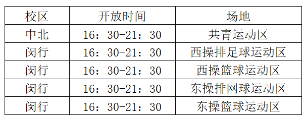
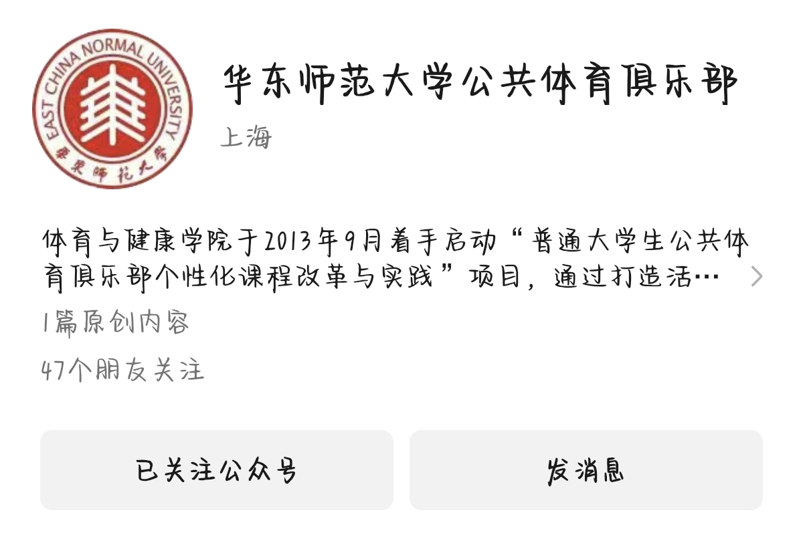

# 校园跑与体育打卡

## 华师大有没有早晚自习 / 早操 / 校园跑？

**没有早晚自习和早操，但会有校园跑！**

> 重要提示：据说 26 秋季开始校园跑打卡可能会变得更加严厉。
>
> 某些逃课方式可能会失效，还请以公共体育俱乐部公告为准。

注：附高校体育 app 使用办法即几种课外体锻的具体介绍，传送门：[2023-2024 学年秋季学期高校体育 app 使用办法](https://mp.weixin.qq.com/s/HWp406xoKAw0P_68TUuZCg)。

校园跑会作为学期内体育成绩的一部分（占 30%），每学期在规定时间前于`高校体育 app`（华师大学生一生之敌）打够 **27 次卡就是课外锻炼部分满分**（100），而校园跑打卡可以分为场地打卡、锻炼打卡和俱乐部课程打卡三种，具体介绍如下：

### 场地打卡

在 app 里找到"运动签到"-"场地签到"（需要定位和蓝牙权限，根据提示开启即可），之后在该场地等待倒计时结束，显示"签到成功"即算一次卡，显示"签到失败"或重进后在锻炼记录中有"预签"字样则没有打上卡，需要重新打卡。<del>（</del>_<del>并不重要</del>_<del>的提示：场地打卡有一些小小的逃课方法使得你不需要一直待在场地）</del>

> 每年秋季运动会期间会有专门的活动卡，可以抵很多打卡次数（最高是抵完整学期的打卡次数），真的很香！

### 锻炼打卡

在 app 里找到"开始跑步"-"体育锻炼"（需要定位和蓝牙权限，根据提示开启即可），之后开始跑步即可，每 1.5 km / 2 km 记一次卡，**每日上限一次**

`（`**`即每天最多只能打 1 次锻炼卡`**`，多出来的有记录但不算在 27 次卡里）`

关于跑步配速、步频、步数、公里数的要求可参考`华东师范大学公共体育俱乐部`公众号推文或官网介绍，这里为方便直接贴出一部分：

1. **每日最多可体育锻炼两次**。其中，同学可以进行一次锻炼打卡，一次场地打卡或俱乐部课程打卡。

2. 健步走成绩有效性判定标准：

3. 补充说明：

（1）必须同时满足以上 4 点要求，才可记作有效考勤一次。

（2）同学们经过一个必经点、两个途经点，<del>自行在操场内</del>完成公里数要求就可以成功完成一次锻炼打卡。打卡过程中经过所有必经点就可以了，不需要一直在操场上跑。

（3）本学期可健步走时间为**06:30-21:30**。（上课时间除外）

### 俱乐部课程打卡

俱乐部课程打卡由于涉及较少，大家可以在上方链接内自行了解。

⭐最后附上官方网址和公众号：

官方网址：<http://peclub.ecnu.edu.cn/>

（该链接须在校园网环境下访问。如果不在教学区，请先连接学校 VPN。）

---

*[内容整理自社区手册 ecnu-guide（CC BY 4.0），作者 Nya桑 等，见 [关于本站](../about.md)。]*
