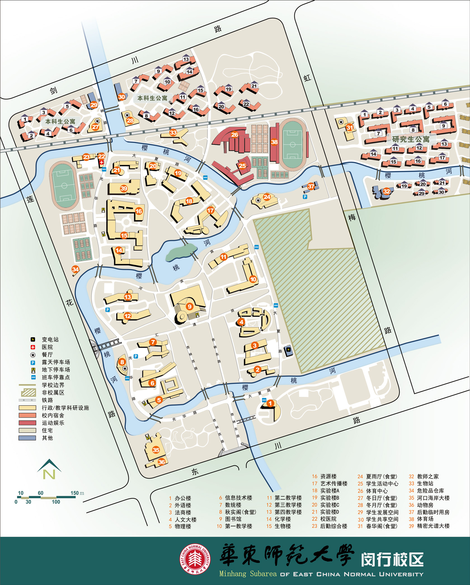
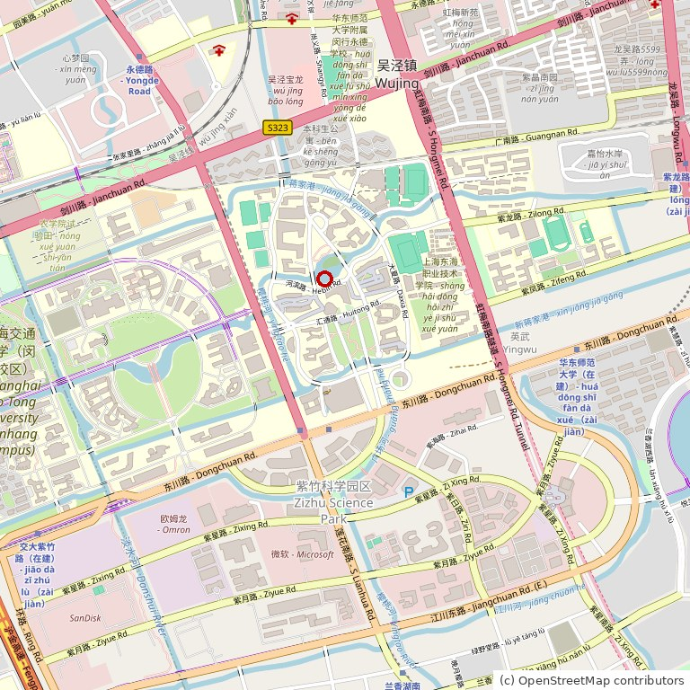

# 闵行校区

## 校区概览

闵行校区位于上海市闵行区东川路 500 号（邮编 200241），2006 年学校主体迁入于此，是华东师范大学的**主校区**。如果说中北校区（[普陀校区](zhongbei.md)）是「小而精」的历史底蕴担当，闵行就是「大而全」的日常生活的主场。

学校现有闵行、普陀等校区，临港新校区已于 2025 年 1 月获教育部批准建设——所以严格来说，华师大不止「两校区」这个说法，未来地图还会继续扩张。

!!! info "关于院系分布"

    闵行校区目前有哪些院系、哪些年级在此就读，近年随学校布局调整变化较大，本页不做具体罗列，**请以学校最新安排为准**。

!!! warning "本站为非官方学生项目"

    页面内容仅供参考，请以学校及相关部门的最新官方通知为准。

## 地图

先上一张平面图，帮你建立对校区的整体印象：

*闵行校区平面图（来源：华东师范大学官网，**2018 版**。闵行校区面积不小，校园布局可能调整，请以学校最新发布为准。）*

再看看校区在上海的位置：

*闵行校区区位图（底图 © OpenStreetMap contributors，仅供参考。）*

想看得更细，可以逛逛官方的 3D 地图：[华东师范大学 3D 校园地图](https://3dmap.ecnu.edu.cn/)。闵行校区步行通勤距离普遍不短，开学前先在地图上认认路，能少走不少冤枉路。

## 功能分区与主要设施

### 教学楼与自习教室

闵行校区的日常上课地点主要是**第一、二、三、四教学楼**，俗称「一教」到「四教」。各教学楼的具体使用安排以每学期课程表和学校通知为准。

2026 秋学期的固定自习教室（8:00 – 22:00，全周开放，信息日期 2026-09，以学校最新通知为准）：

- 第一教学楼自习大厅
- 第四教学楼 411 / 424 / 427

想找空教室自习，可以查[教室信息查询系统](https://jsxx.ecnu.edu.cn/)（网页 / 企业微信 / 教学楼大屏均可查询）。

### 图书馆

闵行校区设有独立图书馆，具体开放时间以官网为准：[图书馆各校区开放时间](https://lib.ecnu.edu.cn/zbxqkfsj/list.htm)。楼层分布与馆藏详情可在[图书馆官网](https://lib.ecnu.edu.cn/)进一步查询。

### 食堂

按后勤保障部的官方口径，**闵行校区共有 5 个学生食堂**（信息日期 2026-09，以[后勤保障部](https://houqin.ecnu.edu.cn/28820/list.htm)最新通知为准）。

具体名称按学校官方 2026 年秋季学期口径：**春华阁、夏雨厅、冬日厅、冬月厅、秋实阁**（信息日期 2026-09，以官方最新通知为准）。

!!! warning "秋实阁 2026 秋季学期大修"

    **秋实阁 2026 年秋季学期正在进行大修**，大修期间的临时供餐点由学校另行通知，就餐请留意后勤保障部的最新公告，别白跑一趟。

!!! tip "秋实阁不只是食堂"

    秋实阁同时也是**闵行 ⇄ 普陀校车的发车点**（秋实阁候车亭），跨校区通勤的同学请记住这个名字，详见[两校区往返交通](transport.md)。

!!! tip "校园卡充值点"

    现金充值点（10:30 – 13:00）：春华阁周一、夏雨厅周二、冬月厅周四。（信息日期 2026-09，以后勤最新通知为准。）

日常吃饭的更多细节（菜系、窗口、踩雷避雷）欢迎参考[餐饮指南](../campus-life/food.md)。

### 宿舍

- 本科生公寓以**四人间**为主（来自学校官方新生住宿指南），具体住宿安排以学校当年通知为准。
- 公开渠道能查到的园区线索包括：虹梅南路公寓、剑川路公寓、东川路创社区公寓、学生之家 A / B 区等；研究生公寓位于春华阁西侧。

宿舍条件、用水作息等详情见[宿舍与用水](../campus-life/dorm.md)。

### 浴室

本科生公寓公共浴室开放时间为**每日 10:30 – 23:00**（信息日期 2026-09）。宿舍楼贴有实时人数二维码，也可以直接查[浴室实时人数查询页](https://houqin.ecnu.edu.cn/ssrscx/list.htm)，避开高峰少排队。

### 快递

- **菜鸟驿站（本科生 8 号楼驿站）**：24 小时可取件，人工服务 8:30 – 19:00。
- **菜鸟驿站（研究生公寓驿站）**：24 小时可取件，人工服务 8:30 – 19:00。

（信息日期 2026-09。）

### 体育场馆

校区内体育设施包括**体育馆、游泳馆、羽乒馆、健身房**以及**东田径场**等（信息来自官方校园地图与体育学院网站，以体育部的最新开放安排为准）。更多运动信息见[运动场馆](../campus-life/sports.md)。

### 校医院

闵行校区校医院门诊时间：工作日 8:00 – 11:30、13:00 – 16:30（挂号提前 10 分钟结束）。咨询电话：54341538（信息日期 2026-09，以校医院最新公告为准）。

需要转诊或夜间就医时，周边公立医保定点医院包括：仁济医院南院区（三级，江月路 2000 号）、复旦大学附属市五医院（三级，瑞丽路 128 号）、闵行区中西医结合医院（二级，剑川路 155 号）。

就医、转诊等详情见[医疗指南](../campus-life/medical.md)。

## 校门分布

闵行校区的四个主要出入口（门牌信息来自学校官方研招公告，开放情况以保卫处最新通知为准）：

- **东门（虹梅南路 5777 号）**
- **南门（东川路 500 号）**：邮寄地址对应的正门方向
- **西门（莲花南路 5005 号）**
- **北门（剑川路 399 号）**

!!! warning "校门信息有时效"

    校门开放情况随校园管理调整变化较快，出行前建议以保卫处最新通知为准。

## 交通接驳

### 地铁

- **15 号线「紫竹高新区站」**是官方认可的接驳站，8 号口离南门 / 西门方向较近（信息来自学校官方交通公告）。出站后仍有一段距离，可公交、骑行或打车接驳。
- **5 号线「东川路站」**：不少第三方攻略会推荐这站，距校区直线不远，但**站点与校门间的接驳情况暂无官方口径，待核实**，建议出行前用地图 App 确认。

!!! warning "别被「华东师范大学站」骗了"

    已开通的 15 号线上**没有「华东师范大学站」**——这个名字属于未来在建新线路的规划站点，开通时间未定。去闵行，请认准**紫竹高新区站**。网上不少攻略把「华东师范大学站」当成闵行的可用站点，属于 <del>望文生义</del> 被站名忽悠了。这个坑在[两校区往返交通](transport.md)里也吐槽过，这里再强调一遍。

### 公交

- **东门**方向：729、958、江川3路、闵行11路、闵行38路
- **北门**方向：457、458、闵行26路区间、闵虹1线、闵吴线、上奉专线

线路信息来自学校官方渠道，请以公交实际运行为准。

### 两校区校车

闵行 ⇄ 普陀校车工作日运行（信息日期 2026-09，以后勤保障部最新班表为准）：

| 方向 | 发车时间 |
|------|----------|
| 普陀 → 闵行 | 6:30、11:50、16:50、21:00 |
| 闵行 → 普陀 | 6:30、11:50、16:50、21:00 |

- 闵行校区发车点：秋实阁候车亭（以此点发车为准）
- 咨询电话：闵行 54345294
- 性质：校车主要服务教职工通勤，在满足教职工乘坐需求的基础上，**空余座位可供学生乘坐**。

更多班次细节与常见问题见[两校区往返交通](transport.md)。

!!! tip "去中北要赶早"

    校车座位有限、不保证人人有座，跨校区上课或办事的同学尽量提前到秋实阁候车亭排队，并预留地铁 15 号线等公共交通备选方案。

!!! info "关于地铁班车"

    2021 年官方文件曾提及往返 5 号线东川路站 / 8 号线沈杜公路站的校内班车，但目前公开渠道无官方时刻表，现状待核实。

## 官方链接汇总

长期有效的官方入口，建议收藏：

- [校情简介](https://www.ecnu.edu.cn/wzcd/xxgk/xqjj.htm) —— 各校区概况官方口径
- [办学地址](https://xxgk.ecnu.edu.cn/3d/b7/c29049a146871/page.htm) —— 各校区地址与邮编
- [后勤保障部·食堂](https://houqin.ecnu.edu.cn/28820/list.htm) —— 食堂通知与用餐服务
- [后勤保障部·医疗](https://houqin.ecnu.edu.cn/dd/29/c40831a515369/page.htm) —— 校医院门诊安排
- [图书馆](https://lib.ecnu.edu.cn/) —— 馆藏、开放时间与借阅服务
- [3D 校园地图](https://3dmap.ecnu.edu.cn/) —— 3D 互动地图，找楼神器

---

*本页信息由网络公开资料整理（信息日期 2026-09），欢迎在 [如何贡献](../contribute.md) 补充更新。*
