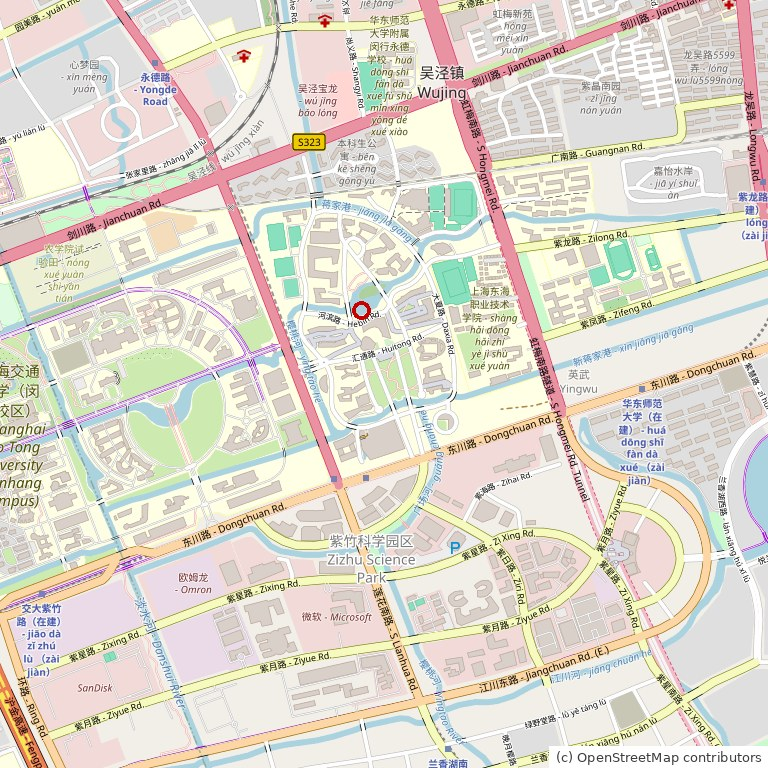
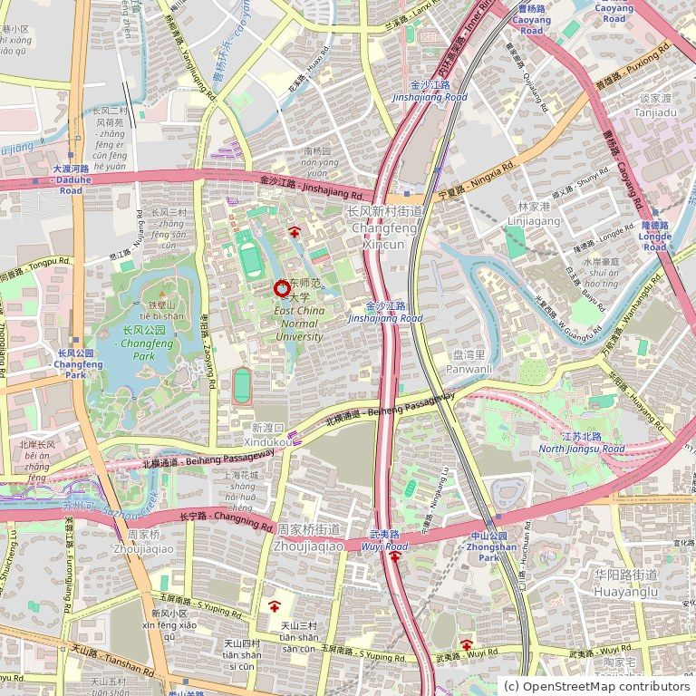

# 两校区往返交通

华东师大有两个主要校区：**闵行校区**（闵行区东川路500号）和**普陀校区**（习惯上也叫"中北校区"，中山北路3663号），直线距离不近，中间隔着大半个上海市区。无论是跨校区上课、听讲座，还是找在另一个校区的同学玩，你都需要一份靠谱的往返攻略。

## 一图流：选哪种方式？

| 方式 | 大致耗时（估算） | 花费（估算） | 适合场景 |
| ---- | ---- | ---- | ---- |
| 校车 | 约 40-60 分钟 | —（建议带校园卡备查） | 工作日固定时段通勤，行李多也不慌 |
| 地铁 | 约 60-70 分钟（含换乘） | 约 5-7 元 | **最推荐**：班次密集，时段自由 |
| 公交 | 1.5 小时以上 | 2-5 元 | 不赶时间的极限省钱党 |
| 打车 / 自驾 | 约 40-60 分钟（视堵车） | 约 80-100 元 | 赶时间、深夜、多人拼车 |

!!! tip "先说结论"

    日常往返首选**地铁**（时段自由）；赶上下班高峰或带着大件行李，**校车**更省心；深夜地铁停运后再考虑**打车**。

以上耗时与费用均为估算，实际请以实时路况和官方最新通知为准。本页信息日期：**2026-09**。

## 校车：躺平直达的首选

校车是两校区之间的直达方式，不用换乘、不用挤地铁。不过要注意：**校车班次主要服务教职工通勤**，在满足教职工乘坐需求的基础上，空余座位可供学生乘坐。建议随身携带校园卡备查。

### 工作日班次（2026-08-31 起）

| 方向 | 发车时间 | 发车点 |
| ---- | ---- | ---- |
| 普陀 → 闵行 | 6:30 / 11:50 / 16:50 / 21:00 | 普陀校区枣阳路788号校门内停车场 |
| 闵行 → 普陀 | 6:30 / 11:50 / 16:50 / 21:00 | 闵行校区秋实阁候车亭（以此发车点为准） |

- 咨询电话：普陀校区 021-62232245；闵行校区 021-54345294
- 目前公开渠道未见明确的双休日/节假日班次安排，请以官方最新通知为准。

!!! warning "错过末班车怎么办"

    21:00 的班次发完就没有了，后续只能靠地铁（15号线末班车时间以[上海地铁官网](https://service.shmetro.com/)为准）或打车。安排跨校区晚课后记得看好返程时间。

- 班次长期查询入口：[后勤保障部校车时刻表](https://houqin.ecnu.edu.cn/28837/list.htm)（班次如有调整以该页为准）

## 地铁：日常主力（推荐）

两校区都不在地铁边上步行可达的位置，但各自有接驳站点：

- **普陀校区（中北）**：金沙江路站（3 / 4 / 13 号线）
- **闵行校区**：紫竹高新区站（15 号线）

!!! warning "别被「华东师范大学站」骗了"

    目前**已开通的 15 号线上并没有「华东师范大学站」**。规划中的新线路未来才可能设这一站，开通时间未定。现阶段去闵行校区，请认准 **紫竹高新区站**——网上不少过时攻略把"华东师范大学站"当成可用站点，这是 <del>想吃但还吃不到</del> 还没兑现的饼。

### 推荐路线

=== "路线一：13 号线换 15 号线（少换乘）"

    金沙江路站乘 **13 号线**（往张江路方向）→ **大渡河路站** 换乘 **15 号线**（往紫竹高新区方向）→ **紫竹高新区站** 下车。

    全程约 60-70 分钟（估算，含换乘与两端接驳）。

=== "路线二：2 号线换 15 号线（官方指南备选）"

    从金沙江路站乘 3 / 4 号线到中山公园站换 **2 号线**（往虹桥方向），至 **娄山关路站** 换乘 **15 号线** → **紫竹高新区站** 下车。

    换乘步行距离稍长，适合 13 号线拥挤或车次衔接不佳时备选。

!!! tip "出站之后"

    紫竹高新区站到闵行校区校门还有一段距离，可换乘公交（如 958 路等，见下节）或骑行、打车接驳。建议提前在地图 App 上确认出入口与目的地距离。

- 时刻表与票价：[上海地铁官网](https://service.shmetro.com/)（[首末班车时刻表](https://service.shmetro.com/hcskb/index.htm)）
- 学校官方交通指南（长期入口）：[本科生招生网·交通指南](https://lxs.ecnu.edu.cn/3f/42/c47490a671554/page.htm)

## 公交

目前**没有**官方确认的两校区直达公交线路。常规做法是地铁接驳公交：

- **中北校区周边**：67、69、224、309、754、765、829、856、909 路等
- **闵行校区周边**：180、729、958 路等（其中 958 路可接驳紫竹高新区站）、江川3路、闵行11路、虹桥枢纽4路等

公交跨校区整体耗时较长（估算 1.5 小时以上），更适合短途接驳（比如地铁站到校门）而不适合全程往返。

## 打车 / 自驾

- 两校区车程约 **25 公里**，打车约 **40-60 分钟**、**约 80-100 元**（以上均为估算，视实时路况浮动很大，早晚高峰请预留更多时间）。
- 多人拼车时人均成本可控，深夜返程（地铁停运后）是常见使用场景。
- 自驾进校需遵守学校机动车通行管理规定，详见保卫处相关文件（[机动车通行证登记管理细则](https://bwc.ecnu.edu.cn/7d/68/c10638a425320/page.htm)）。

!!! warning "高峰期谨慎打车"

    工作日晚高峰金沙江路—内环一带和虹梅南路隧道都比较堵，赶时间的话校车/地铁反而更稳。

## 常见问题

**Q：跨校区上课选哪个校区更省事？**

单纯从交通看，两校区之间的通勤成本不低（地铁单程 60-70 分钟估算），如果一门课需要长期跨校区上，建议把它排进整块时间段，优先卡校车班次（6:30 / 11:50 / 16:50 / 21:00）。

**Q：校车是免费的吗？需要买票吗？**

校车主要服务教职工通勤，空余座位可供学生乘坐，公开资料中未见对学生收费或购票的说明，具体以乘坐时现场要求为准；建议随身携带校园卡备查。

**Q：周末能坐校车吗？**

目前公开的班次口径为工作日班次（2026-08-31 起），双休日与节假日的安排请以[后勤保障部校车时刻表](https://houqin.ecnu.edu.cn/28837/list.htm)的最新通知为准。

**Q：15 号线不是有「华东师范大学站」吗？**

那是规划中的新线路（开通时间未定），已开通的 15 号线上没有这一站。现阶段往返闵行校区请使用紫竹高新区站。

## 官方链接汇总

| 入口 | 链接 | 说明 |
| ---- | ---- | ---- |
| 校车时刻表 | <https://houqin.ecnu.edu.cn/28837/list.htm> | 班次调整以该页为准 |
| 官方交通指南 | <https://lxs.ecnu.edu.cn/3f/42/c47490a671554/page.htm> | 本科生招生网长期入口 |
| 上海地铁官网 | <https://service.shmetro.com/> | 时刻表、票价、首末班车 |
| 后勤保障部 | <https://houqin.ecnu.edu.cn/> | 校车、食堂、宿舍等综合服务 |

---

*本页信息由网络公开资料整理（信息日期 2026-09），欢迎在 [如何贡献](../contribute.md) 补充更新。*
