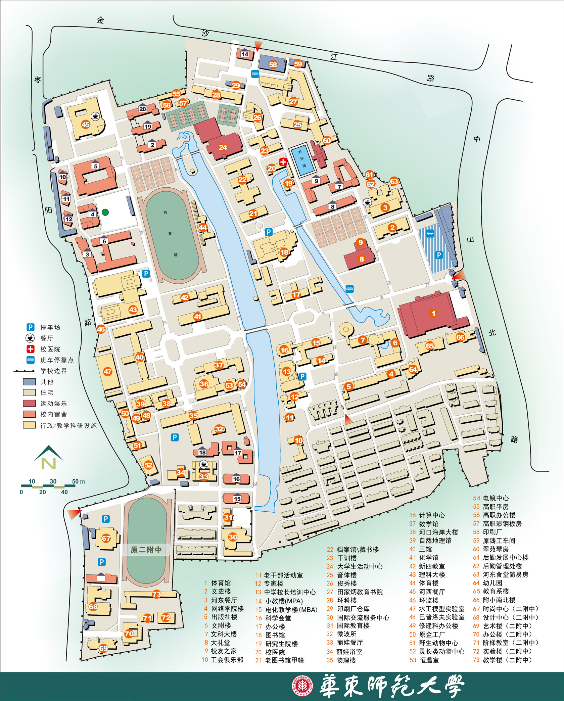
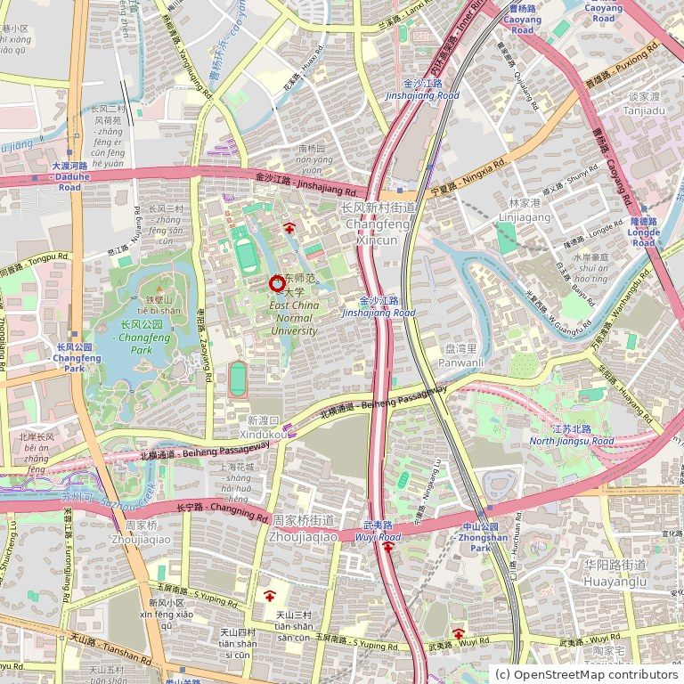

# 中北校区

## 校区概览

中北校区（官方现称**普陀校区**）位于中山北路 3663 号，是华东师范大学的发源地。校区规模不大、五脏俱全——从东头走到西头也就十几分钟，但教学楼、食堂、图书馆、体育馆一应俱全，日常通勤基本靠步行。

贯穿校园的**丽娃河**是华师大的「校河」，也是这所学校最出名的意象之一。沿河散步、在河边背书、考试周在河边发呆，都是中北人的日常。据公开资料，这里曾是大夏大学的原址所在地，校内不少建筑和路名都带着这段沿革。

!!! info "关于院系分布"

    中北校区目前有哪些院系、哪些年级在此就读，近年随学校布局调整变化较大，本页不做具体罗列，**请以学校最新安排为准**。

!!! warning "本站为非官方学生项目"

    页面内容仅供参考，请以学校及相关部门的最新官方通知为准。

## 地图

先上一张平面图，帮你建立对校区的整体印象：

*普陀校区平面图（来源：华东师范大学官网，**2018 版**。校园布局可能调整，请以学校最新发布为准。）*

再看看校区在上海市区的位置：

*中北校区区位图（底图 © OpenStreetMap contributors，仅供参考。）*

想看得更细，可以逛逛官方的 3D 地图：[华东师范大学 3D 校园地图](https://3dmap.ecnu.edu.cn/)，以及官方图文版[普陀校区平面图介绍](https://geo.ecnu.edu.cn/2c/a6/c43032a601254/page.htm)。

## 功能分区与主要设施

### 食堂

中北的食堂包括：**河东食堂、河西食堂、丽娃食堂**，另有**白玉路学生食堂**。教工餐厅位于河东食堂 3 楼，河西食堂 1 楼设有教工窗口。

!!! tip "认准丽娃河"

    校内不少地点以「河东」「河西」「丽娃」命名——记住了这条校河，找食堂、认方位心里更有谱。

基本伙食的用餐时间（信息日期 2026-09，以食堂现场安排为准）：

| 时段 | 时间 |
|------|------|
| 早餐 | 6:30 – 9:00 |
| 中餐 | 10:30 – 13:00 |
| 晚餐 | 16:30 – 19:00 |

!!! tip "风味餐厅没有早餐"

    想吃风味窗口的同学注意，风味餐厅**不供应早餐**，早起请直奔基本伙食窗口。

!!! tip "校园卡充值点"

    现金充值点（8:00 – 13:00）：河东食堂周一、周四；河西食堂周二；丽娃食堂周三、周五。（信息日期 2026-09，以后勤最新通知为准。）

### 图书馆

普陀校区设有独立图书馆，具体开放时间以官网为准：[图书馆各校区开放时间](https://lib.ecnu.edu.cn/zbxqkfsj/list.htm)。楼层分布与馆藏详情可在图书馆官网进一步查询。

### 自习教室

2026 秋学期的固定自习教室（8:00 – 22:00，全周开放，信息日期 2026-09，以学校最新通知为准）：

- 文史楼 103 / 105
- 教书院 102 / 110

想找空教室自习，可以查[教室信息查询系统](https://jsxx.ecnu.edu.cn/)（网页 / 企业微信 / 教学楼大屏均可查询）。

### 浴室

中北校区浴室开放时间为**每日 15:00 – 23:00**（信息日期 2026-09）：

- 河西浴室（2026-09-04 起试运行）
- 河东女浴室
- 丽娃浴室

部分宿舍楼内有独立卫浴，具体条件因楼而异，详见[宿舍与用水](../campus-life/dorm.md)。

### 快递

- **菜鸟驿站**：枣阳路驿站，24 小时可取件，人工服务 8:30 – 19:00（信息日期 2026-09）。
- **大件行李临时点**：报到季在体育馆一楼设临时收发点，军训 / 换季寄行李箱很方便。

### 校医院

普陀校区校医院门诊时间：工作日 8:00 – 11:30、13:00 – 16:30（挂号提前 10 分钟结束）。咨询电话：62232375（信息日期 2026-09，以校医院最新公告为准）。

需要转诊或夜间就医时，周边公立医保定点医院包括上海中医药大学附属普陀医院（三级，兰溪路 164 号）、普陀区人民医院（二级，江宁路 1291 号）、利群医院（二级，桃浦路 910 号）。

### 其他

体育馆等体育场馆、教学楼的相对位置可参考上文平面图；宿舍区分布在校园周边（白玉路宿舍区、中江路公寓、和欣公寓等，具体住宿安排以学校最新通知为准）。

## 校门分布

中北校区的主要出入口如下（沿革信息来自官方新闻与公开通知）：

- **正门（中山北路 3663 号）**：2021 年 7 月修缮后重新启用，是校区的主门面，访客和大部分新生报到从这里进。
- **枣阳路 788 号门（西门）**：老华师大人熟悉的「华东师大后门」，2020 年 10 月重新开放。**目前是普陀 ⇄ 闵行校车的发车点**，发车点位于该校门内停车场。
- **金沙江路 135 号门**：2021 年 7 月起行人与非机动车通行关闭，以最新通告为准。

!!! warning "校门信息有时效"

    校门开放情况随校园管理调整变化较快，出行前建议以保卫处最新通知为准。

## 交通接驳

### 地铁

最近的地铁站是**金沙江路站**，为 3 / 4 / 13 号线换乘站，出站步行约 300 米即到校门（步行距离为第三方测算，仅供参考）。三线换乘的便利程度在市中心高校里数一数二，去哪儿都方便。

### 公交

「华东师大站」途经线路：67、69、224、309、754、765、829、856、909 路（线路信息来自学校官方页面，请以公交实际运行为准）。

### 两校区校车

工作日运行（信息日期 2026-09，以后勤保障部最新班表为准）：

| 方向 | 发车时间 |
|------|----------|
| 普陀 → 闵行 | 6:30、11:50、16:50、21:00 |
| 闵行 → 普陀 | 6:30、11:50、16:50、21:00 |

- 普陀校区发车点：枣阳路 788 号校门内停车场
- 闵行校区发车点：秋实阁候车亭（以此点发车为准）
- 咨询电话：普陀 62232245
- 性质：校车主要服务教职工通勤，在满足教职工乘坐需求的基础上，**空余座位可供学生乘坐**。

!!! tip "回闵行要赶早"

    校车座位有限、不保证人人有座，跨校区上课或办事的同学尽量提前到发车点排队，并预留公共交通备选方案。

## 官方链接汇总

长期有效的官方入口，建议收藏：

- [华东师范大学 3D 校园地图](https://3dmap.ecnu.edu.cn/) —— 3D 互动地图，找楼神器
- [普陀校区平面图介绍](https://geo.ecnu.edu.cn/2c/a6/c43032a601254/page.htm) —— 官方图文版平面图
- [图书馆各校区开放时间](https://lib.ecnu.edu.cn/zbxqkfsj/list.htm) —— 图书馆开放安排
- [后勤保障部·中北校区栏目](https://life.ecnu.edu.cn/zb/list.htm) —— 食堂、浴室、班车等生活服务通知
- [教室信息查询系统](https://jsxx.ecnu.edu.cn/) —— 空教室与课程查询

---

*本页信息由网络公开资料整理（信息日期 2026-09），欢迎在 [如何贡献](../contribute.md) 补充更新。*
