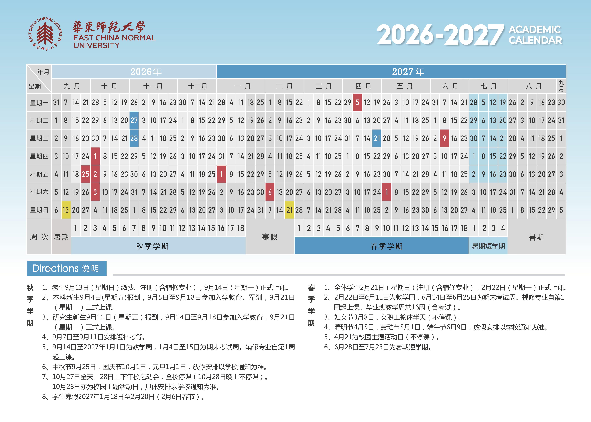

# 校历与放假安排

**校历待更新**，2026-2027 学年校历如下，[PDF 版本](https://bksy.ecnu.edu.cn/b6/32/c40631a767538/page.htm)见华东师大本科生院网站。

## 校历上写的国庆节只放假 3 天是为什么？

校历上的放假是按照未调休的国家法定节假日写的，没有涉及调休。**事实上我校所有放假时间都和调休后的国家放假办法一致**<del>，也许这就是部属高校带给我的自信吧（）</del>

---

*[内容整理自社区手册 ecnu-guide（CC BY 4.0），作者 Nya桑 等，见 [关于本站](../about.md)。]*
